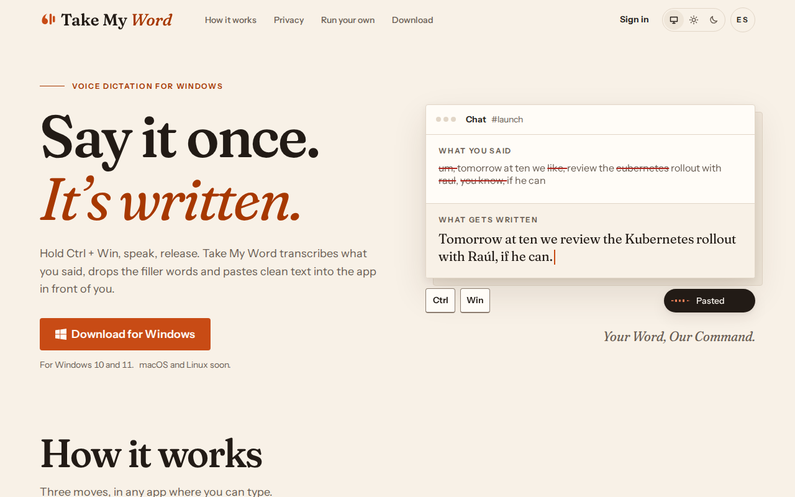
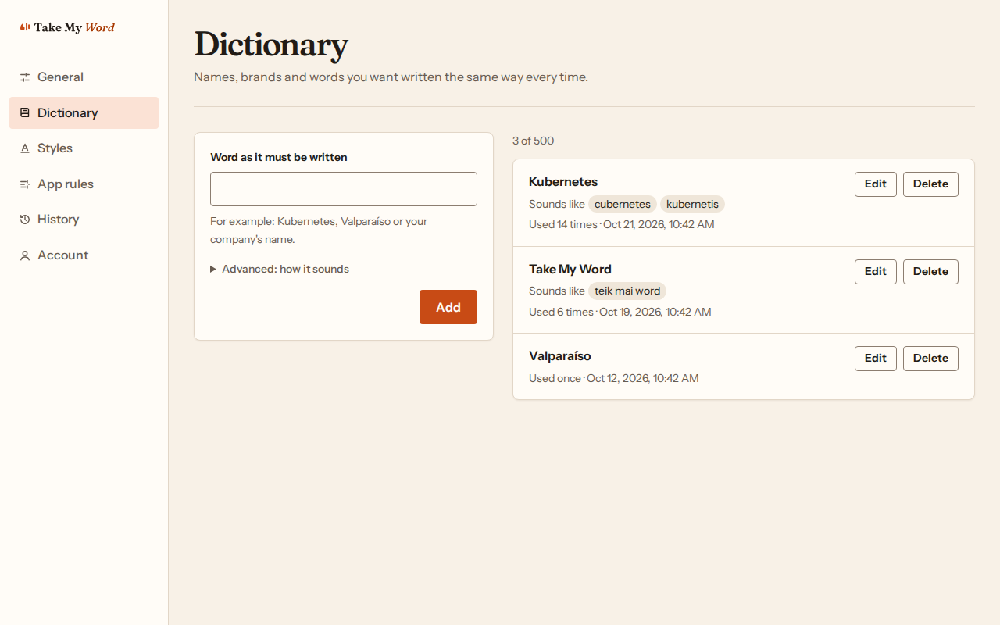

# Take My Word

Voice dictation for Windows: hold Ctrl + Win, speak, release, and clean text lands in the app you are using.
It drops the filler words, spells your own names and jargon the way you do, follows a style per app, and works in English and Spanish.
Audio is never stored; the text is kept 90 days so you can find it, and you can delete it sooner.

## Run your own

Take My Word is open source, and you can run the whole service in your own AWS account, with your own Groq and OpenAI keys, for about 2 USD a month at 15 minutes of dictation a day.
The official desktop app connects to it through "Use your own server" on its sign-in step.

- **Recommended:** let [Claude Code](https://claude.com/claude-code) set it up with the self-host skill; it asks only what it needs and runs every step for you.
- **By hand:** `pnpm selfhost` asks the same questions in your terminal.

Both are explained step by step, with what you need, the real cost, updates and removal, in [self-host/README.md](self-host/README.md).

## Develop

A pnpm monorepo: `apps/api` (Lambda), `apps/web` (Next.js), `apps/desktop` (Tauri), `packages/shared` (the contracts every client imports) and `infra/` (Terraform).
Start with [docs/TRD.md](docs/TRD.md) for the stack and commands, [docs/PRD.md](docs/PRD.md) for what the product does and [docs/ARD.md](docs/ARD.md) for the decisions.

## License

[MIT](LICENSE).
