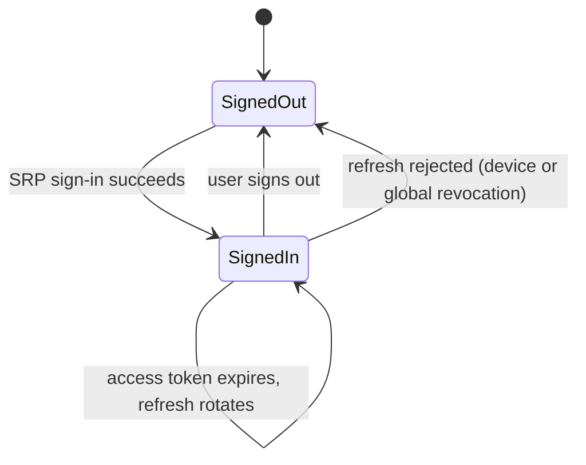
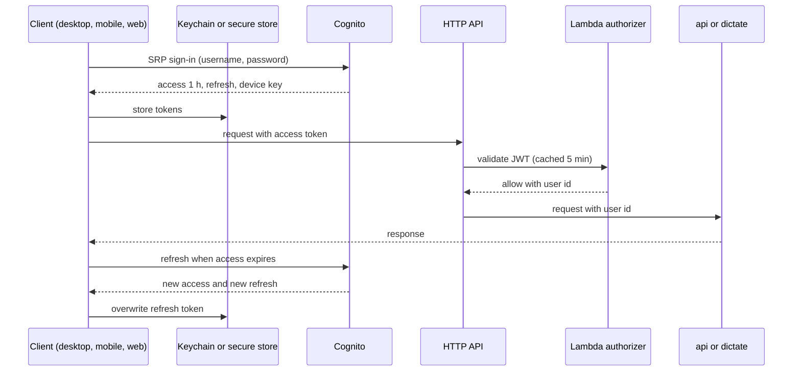
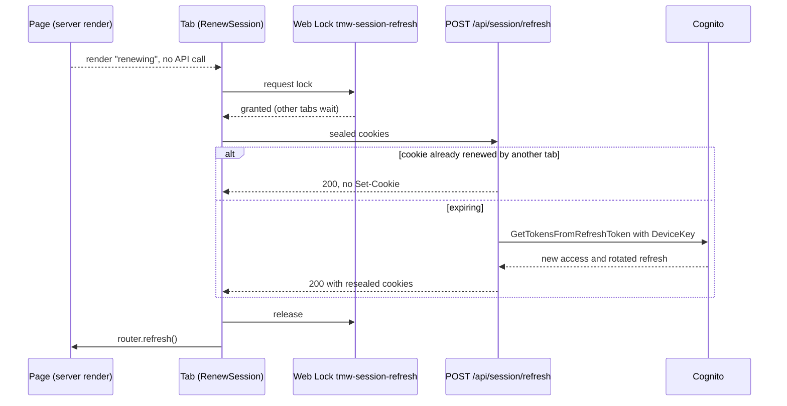

# Auth: flows

Only flows that deserve a diagram. A CRUD does not.

## Client session

Runs in desktop, mobile and web from launch to sign-out.

## Sign-in and authorized call

Runs on first sign-in on a device and on every API call after it.

## Web session renewal

Runs when a page of `/app` finds the access token in its last minute.
Cognito keeps only the refresh token of the renewal that finished last, so tabs renew one at a time.

A rejected or reused refresh token answers 401 and the tab goes to sign-in; Cognito unreachable answers 503 and keeps the cookies.
