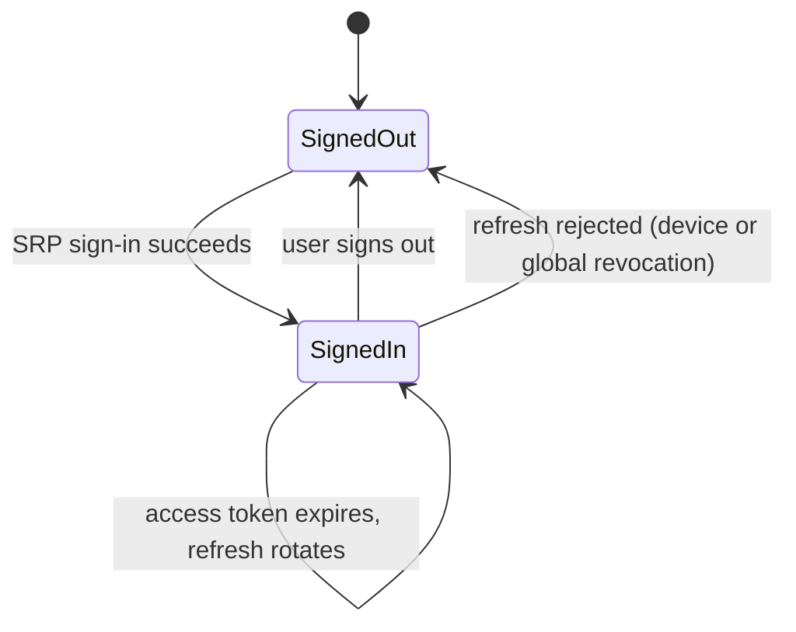
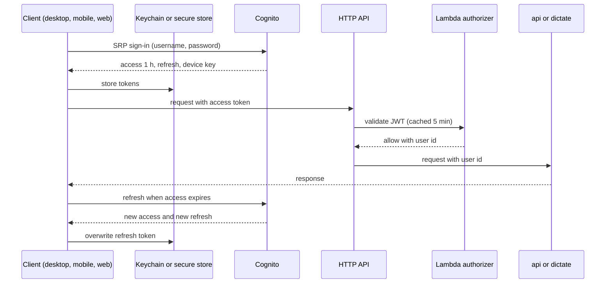

# Auth: flows

Only flows that deserve a diagram. A CRUD does not.

## Client session

Runs in desktop, mobile and web from launch to sign-out.

## Sign-in and authorized call

Runs on first sign-in on a device and on every API call after it.

