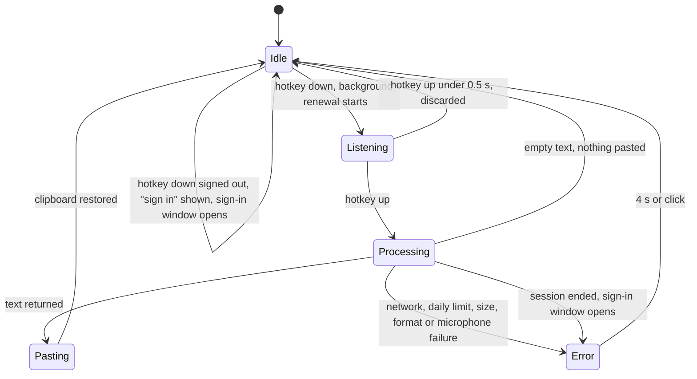
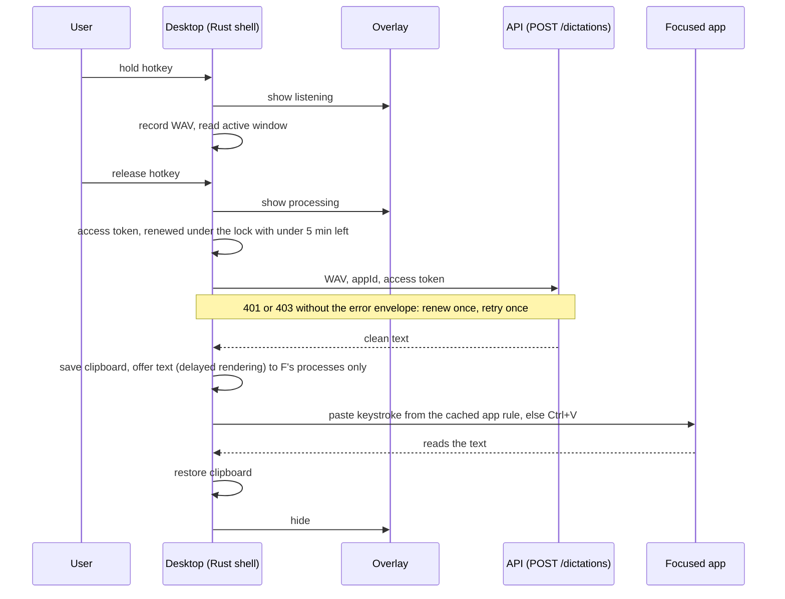

# Desktop: flows

Only flows that deserve a diagram. A CRUD does not.

## Hold to talk

Runs every time the user holds the hotkey.
An error closes after 4 s or on click; a failure that lands while the next hold is open arrives as a notification instead.
Every caller of the session waits on one lock, so only one renewal runs at a time; the hotkey only reads a flag and never waits.

