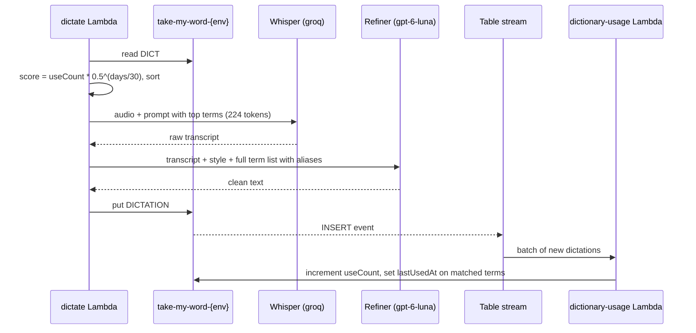

# Dictionary: flows

Only flows that deserve a diagram. A CRUD does not.

## Usage and ranking

Runs on every dictation: `dictate` reads and ranks the terms before calling providers, and the saved dictation later feeds usage back through the table stream.

The silence guard can end a dictation before the refiner; whether such a dictation is saved and counted is.
