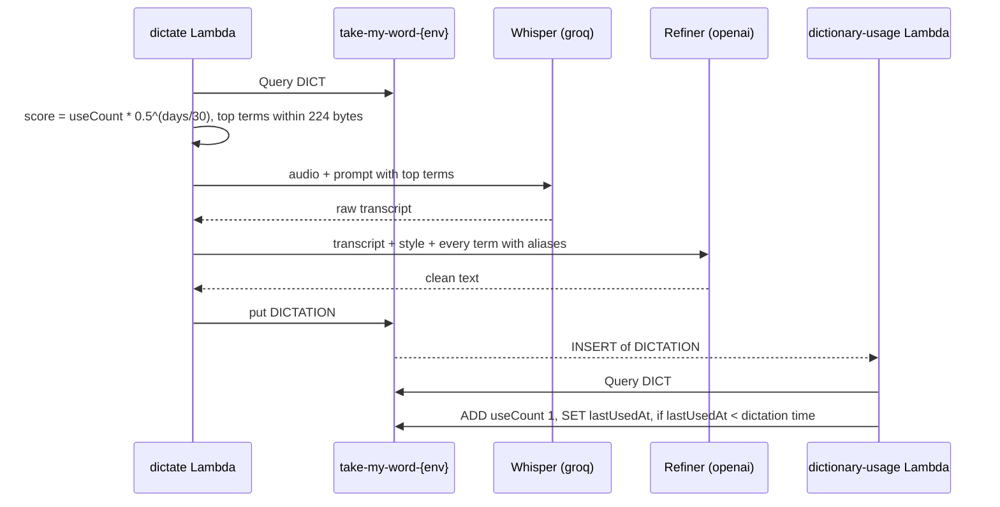

# Dictionary: flows

Only flows that deserve a diagram. A CRUD does not.

## Usage and ranking

`dictate` reads and ranks the terms before calling providers; the saved dictation later feeds usage back through the table stream.
Skipped silence is never saved, so it never counts.

