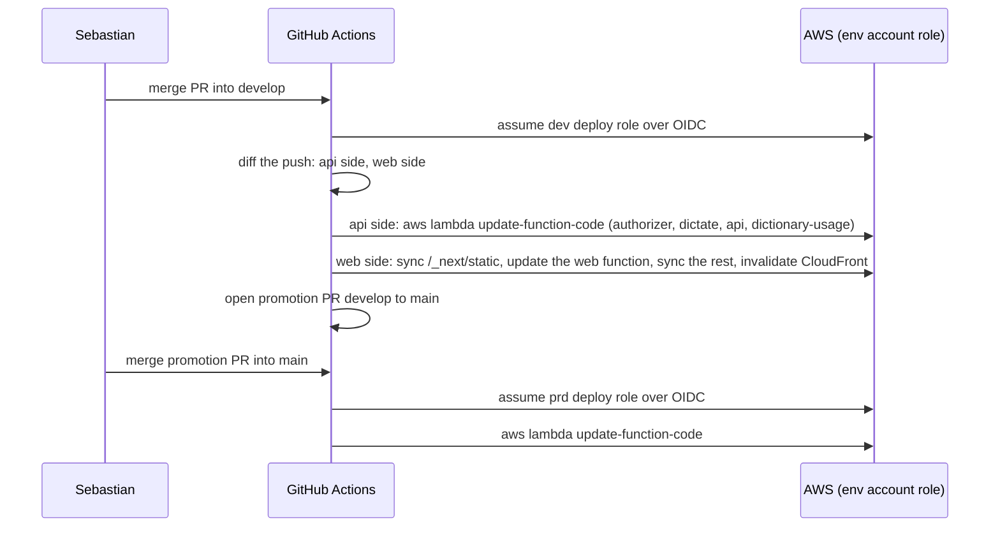

# Infra: flows

Only flows that deserve a diagram.

## Deploy and promotion

Runs on every merge to `develop` and to `main` that touches a deployable app.

Infrastructure changes never take this path: Sebastian runs Terraform from his machine, and the Lambda module ignores the code fields so the next apply does not undo a deploy.
