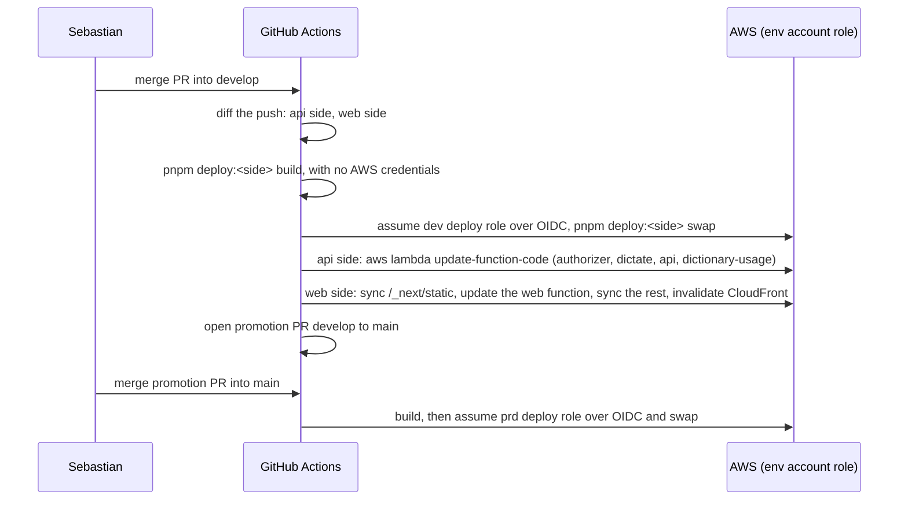
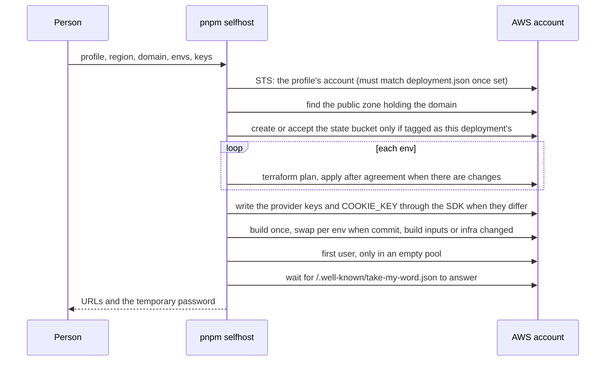

# Infra: flows

Only flows that deserve a diagram.

## Deploy and promotion

Runs on every merge to `develop` and to `main` that touches a deployable app.

Infrastructure changes never take this path: Sebastian runs Terraform from his machine, and the Lambda module ignores the code fields so the next apply does not undo a deploy.

## Self-host setup and update

`pnpm selfhost` (or the skill, which runs it with `--yes` after showing `--plan`); every step is idempotent, so a failed run is fixed by running it again.

`pnpm selfhost remove` lifts deletion protection and the secret recovery window, destroys every env, deletes its own state bucket, then polls the account until nothing tagged or named for the deployment is left.
